# llm-guardrails-benchmark

<!-- adam-badges:start -->
[](CHANGELOG.md)
[](https://github.com/Adam-Blf/llm-guardrails-benchmark/actions/workflows/ci.yml)
[](https://github.com/Adam-Blf/llm-guardrails-benchmark/commits)
[](https://hits.sh/github.com/Adam-Blf/llm-guardrails-benchmark/)
[](https://github.com/Adam-Blf/llm-guardrails-benchmark/commits)
[](https://github.com/Adam-Blf/llm-guardrails-benchmark)
[](LICENSE)
[](https://colab.research.google.com/github/Adam-Blf/llm-guardrails-benchmark/blob/main/notebooks/benchmark_colab.ipynb)
<!-- adam-badges:end -->

Benchmark de guardrails pour la sécurité des LLM et des agents LLM. Projet du cours MLOps (XDE826) du Mastère Data Engineering et IA de l'EFREI, réalisé en binôme.

Le dépôt contient une cartographie des risques rattachée aux référentiels OWASP, MITRE ATLAS et NIST, une méthode d'évaluation qu'on peut rejouer en une commande, et la comparaison mesurée de dix guardrails sur sept familles de risque, en anglais et en français. Le rapport complet est en PDF dans [`reports/`](reports/rapport-guardrails-llm.pdf) et attaché à chaque release.

## Objectifs

1. Cartographier les risques de sécurité des LLM et des agents en production à partir de la littérature et des référentiels publics ([`docs/risk-taxonomy.md`](docs/risk-taxonomy.md)).
2. Sélectionner et faire tourner des guardrails représentatifs : GLiNER2, Llama Guard, NeMo Guardrails, Rebuff, Lakera Guard, LLM Guard, Presidio, DeBERTa de Protect AI, Prompt-Guard et une référence par motifs.
3. Concevoir une méthode d'évaluation justifiée et reproductible ([`docs/methodology.md`](docs/methodology.md)).
4. Comparer les outils et en tirer des recommandations par contexte d'usage ([`docs/results.md`](docs/results.md)).

## Résultats en bref

Exécution de référence `cpu-baseline` : 1 240 entrées, 100 par classe et par famille (50 pour l'injection indirecte), graine 42, portable Intel Core i7-1185G7 sans GPU. Le J de Youden vaut rappel moins taux de faux positifs. Il vaut 0 pour un outil qui bloque tout, là où le F1 afficherait 0,67. Les colonnes « attaques » moyennent les quatre familles d'injection et de jailbreak.

<!-- table:overall:start -->
| Outil | J attaques | F1 attaques | J familles revendiquées | FPR bénin FR | p50 (ms) | p95 (ms) | h-machine / 1 000 |
|---|---|---|---|---|---|---|---|
| `gliner2_gliguard` | 0.52 | 0.70 | 0.54 | 0.04 | 370 | 1047 | 0.124 |
| `protectai_deberta_v2` | 0.47 | 0.73 | 0.47 | 0.16 | 471 | 1858 | 0.193 |
| `llm_guard` | 0.30 | 0.72 | 0.38 | 0.26 | 3064 | 14136 | 1.374 |
| `llama_guard3_1b` | 0.30 | 0.63 | 0.37 | 0.01 | 2255 | 7489 | 1.152 |
| `regex_baseline` | 0.27 | 0.53 | 0.24 | 0.03 | 0.3 | 2.7 | 0.000 |
| `nemo_guardrails` | 0.22 | 0.47 | 0.22 | 0.53 | 1405 | 6104 | 0.583 |
| `presidio` | 0.17 | 0.65 | 0.51 | 0.46 | 40 | 179 | 0.016 |
| `gliner2_pii` | 0.14 | 0.65 | 0.77 | 0.14 | 558 | 1845 | 0.209 |
| `rebuff_heuristic` | 0.00 | 0.00 | 0.00 | 0.00 | 111998 | 1035475 | 57.579 |
<!-- table:overall:end -->

Le détail par famille, les intervalles de confiance et les recommandations sont dans [`docs/results.md`](docs/results.md).

## Architecture

```mermaid
flowchart LR
    subgraph Data["Données épinglées"]
        HF[(Hub Hugging Face)]:::input
        GH[(BIPIA, InjecAgent sur GitHub)]:::input
        FR[Pièges lexicaux FR]:::input
    end
    HF --> L[Loaders et échantillonnage stratifié]:::process
    GH --> L
    FR --> L
    L --> S[Suite de 1 240 entrées]:::store
    S --> R[Runner : chauffe, mesure, reprise]:::process
    subgraph Tools["Adaptateurs Guardrail"]
        A1[Règles : regex, Rebuff]:::process
        A2[Encodeurs : DeBERTa, GLiNER2, Presidio, LLM Guard]:::process
        A3[LLM juges : Llama Guard, NeMo via Ollama]:::process
        A4[API : Lakera]:::error
    end
    R --> Tools
    Tools --> P[(results/run/predictions/*.csv)]:::store
    P --> M[Analyse : métriques, IC bootstrap, couverture]:::process
    M --> T[(metrics, overall, coverage .csv)]:::store
    T --> F[Figures matplotlib]:::ok
    T --> D[Tables Markdown]:::ok
    F --> PDF[Rapport PDF FPDF2]:::ok
    D --> PDF
    classDef input fill:#2563eb,stroke:#1e3a8a,color:#fff
    classDef process fill:#7c3aed,stroke:#4c1d95,color:#fff
    classDef store fill:#f59e0b,stroke:#92400e,color:#111
    classDef ok fill:#16a34a,stroke:#14532d,color:#fff
    classDef error fill:#dc2626,stroke:#7f1d1d,color:#fff
```



Le paquet `src/guardbench` suit ce découpage : `data/` (sources épinglées et tranches), `adapters/` (un fichier par outil derrière l'interface `Guardrail`), `runner.py`, `metrics.py`, `analysis.py`, puis `report/` (figures, tables, moteur PDF). Les adaptateurs en rouge ont besoin d'un accès externe et sont sautés proprement sans lui.

## Lancer le benchmark

### En local

```bash
python -m venv .venv && source .venv/bin/activate      # Windows : .venv\Scripts\activate
pip install torch --index-url https://download.pytorch.org/whl/cpu
pip install -e ".[tools,dev]" -c docker/constraints.txt
pip install --no-deps rebuff==0.1.1
python -m spacy download en_core_web_sm && python -m spacy download fr_core_news_sm
ollama pull llama-guard3:1b && ollama pull qwen2.5:1.5b

python -m guardbench list                      # outils disponibles et raisons d'indisponibilité
python -m guardbench run --workers 6           # prédictions dans results/cpu-baseline
python -m guardbench analyse                   # tables CSV
python -m guardbench figures --out reports/figures/cpu-baseline
python -m guardbench tables                    # met à jour les tableaux de docs/results.md et du README
python -m guardbench report                    # rapport PDF dans reports/
python scripts/check_report.py                 # contrôle de mise en page du PDF
```

Rebuff s'installe à part avec `--no-deps` parce que son paquet fige LangChain 0.1 et NumPy 1. Seul son module heuristique est utilisé.

### Avec Docker

Une seule commande construit l'image, démarre Ollama, télécharge Llama Guard 3 1B et Qwen2.5 1.5B, puis exécute tous les outils CPU, l'analyse et les figures :

```bash
docker compose up --build
```

Les résultats arrivent dans `results/docker-cpu` (variable `RUN_NAME` pour changer de nom).

### Lancer sur Colab

[](https://colab.research.google.com/github/Adam-Blf/llm-guardrails-benchmark/blob/main/notebooks/benchmark_colab.ipynb)

Le notebook `notebooks/benchmark_colab.ipynb` relance le même CLI sur un GPU T4 gratuit, avec 250 exemples par classe et des modèles plus lourds (Llama Guard 3 1B et 8B via `transformers`, Prompt-Guard-86M). Il écrit dans `results/colab-gpu` puis propose les résultats en archive zip. Les latences GPU sont rapportées à part et ne se comparent pas aux latences CPU.

### Variables d'environnement

| Variable | Rôle | Obligatoire |
|---|---|---|
| `LAKERA_API_KEY` | active l'adaptateur Lakera Guard | non, l'outil est sauté sans elle |
| `HF_TOKEN` | modèles Meta à licence (Prompt-Guard, Llama Guard via `transformers`) | non, ces outils sont sautés sans lui |
| `OLLAMA_HOST` | serveur Ollama pour Llama Guard et NeMo | non, défaut `http://127.0.0.1:11434` |

Copier `.env.example` en `.env` pour les renseigner. Le fichier `.env` est ignoré par Git.

## Qualité

Tests `pytest` sur les métriques, les jeux de données, le runner, les figures, le moteur PDF et chaque adaptateur (modèles et réseau simulés), `ruff` en lint, et une CI GitHub Actions qui ne télécharge aucun modèle. Les releases sont publiées sur tag par un workflow qui vérifie la version, joint le wheel et le PDF, et pousse l'image sur GHCR.

## Auteurs

- Adam Beloucif ([Adam-Blf](https://github.com/Adam-Blf))
- Emilien Morice ([emilien754](https://github.com/emilien754))

Licence MIT. Les jeux de données gardent leur propre licence, listée dans `results/cpu-baseline/run_meta.json`.
