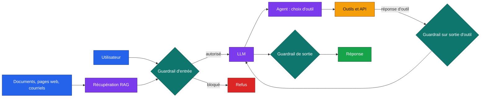

# Cartographie des risques de sécurité des LLM et des agents LLM

Ce document recense les risques qu'un système à base de grand modèle de langage (LLM) rencontre une fois en production, qu'il s'agisse d'un assistant conversationnel, d'un pipeline RAG ou d'un agent qui appelle des outils. Nous l'avons construit à partir de trois référentiels publics et d'une revue de la littérature académique. Chaque risque est rattaché au référentiel OWASP Top 10 for LLM Applications 2025 [1], aux techniques MITRE ATLAS [2] et aux catégories du profil NIST AI 600-1 [3]. La dernière colonne dit si le benchmark le mesure, et avec quelle tranche de données.

## Périmètre et méthode de revue

Nous avons retenu les sources selon deux critères. Il fallait soit un référentiel maintenu par un organisme reconnu (OWASP, MITRE, NIST, Commission européenne), soit un article évalué par les pairs ou largement repris qui propose une attaque, un jeu de données ou une défense mesurable. Les billets de blog sans protocole n'ont pas été retenus. La revue couvre 2021 à 2026, avec une attention particulière aux agents, sujet où la littérature a beaucoup bougé depuis 2024.

Le benchmark ne couvre qu'une partie de la carte. Un guardrail d'entrée, celui que nous testons, lit un texte et décide de le bloquer ou non. Il ne voit ni les poids du modèle, ni la chaîne d'approvisionnement, ni la consommation de ressources. Les risques hors de sa portée restent dans la carte pour que le lecteur sache ce qu'un guardrail ne protège pas.

## Vue d'ensemble

Le schéma situe les trois points de contrôle d'une application à base d'agent. Le benchmark évalue le premier (entrée utilisateur) et le deuxième (contenu externe et réponses d'outils), parce que c'est là que se jouent l'injection directe, l'injection indirecte et le détournement d'outils.

## Carte détaillée

### R1. Injection de prompt directe

L'utilisateur écrit des instructions qui cherchent à remplacer celles du développeur, par exemple « ignore les instructions précédentes », un changement de rôle ou une fausse balise système. Perez et Ribeiro ont formalisé le détournement d'objectif et la fuite de prompt dès 2022 [5]. Liu et al. ont proposé un cadre qui unifie les variantes et compare dix défenses [8], et HouYi a montré la faisabilité sur des applications réelles [9]. Le phénomène tient à une limite de conception plus qu'à un bogue, puisque le modèle reçoit instructions et données dans le même canal. La hiérarchie d'instructions de Wallace et al. réduit le problème sans le résoudre [20].

- OWASP : LLM01 Prompt Injection. ATLAS : AML.T0051.000 (LLM Prompt Injection: Direct). NIST : Information Security.
- Benchmark : tranche `direct_injection` (deepset/prompt-injections, safe-guard-prompt-injection).

### R2. Jailbreak

Le jailbreak vise à lever l'alignement de sécurité pour obtenir un contenu que le modèle refuserait. Wei et al. l'expliquent par deux mécanismes, la compétition d'objectifs et la généralisation incomplète de l'entraînement de sécurité [11]. Shen et al. ont analysé 1 405 prompts de jailbreak collectés entre décembre 2022 et décembre 2023, dont certains optimisés par les mêmes comptes pendant plus de cent jours [12]. Zou et al. ont produit des suffixes adversariaux optimisés qui se transfèrent d'un modèle à l'autre [13]. La frontière avec l'injection est floue. Dans ce projet nous gardons la distinction d'OWASP, où le jailbreak cible la politique de contenu, l'injection cible les instructions de l'application.

- OWASP : LLM01 (le jailbreak y est traité comme une forme d'injection). ATLAS : AML.T0054 (LLM Jailbreak). NIST : Dangerous, Violent, or Hateful Content ; CBRN Information.
- Benchmark : tranche `jailbreak` (jackhhao/jailbreak-classification).

### R3. Injection de prompt indirecte

L'instruction malveillante n'est plus tapée par l'utilisateur. Elle arrive dans un document récupéré, une page web, un courriel ou un commentaire de code que l'application place dans le contexte. Greshake et al. ont décrit cette classe en 2023 et l'ont mise en oeuvre contre Bing Chat et des extensions de code [4]. L'utilisateur légitime peut être la victime. BIPIA mesure cette vulnérabilité sur plusieurs tâches réalistes (courriel, tableau, résumé, question-réponse, code) et propose des défenses en boîte noire et en boîte blanche [6]. Le spotlighting propose de marquer les données externes pour que le modèle les distingue des instructions [19].

- OWASP : LLM01 (variante indirecte) ; LLM08 Vector and Embedding Weaknesses quand la charge passe par l'index vectoriel. ATLAS : AML.T0051.001 (LLM Prompt Injection: Indirect). NIST : Information Security ; Information Integrity.
- Benchmark : tranche `indirect_injection` (courriels BIPIA, version propre et version piégée du même courriel).

### R4. Abus des actions d'un agent

Un agent qui dispose d'outils (envoi de courriel, paiement, domotique, exécution de code) transforme une injection réussie en action dans le monde réel. InjecAgent a construit 1 054 cas sur 17 outils utilisateur et 62 outils d'attaquant, et mesuré qu'un agent ReAct sur GPT-4 suivait l'instruction injectée dans 24 % des cas, presque deux fois plus avec une attaque renforcée [7]. AgentDojo évalue le compromis entre utilité et sécurité sur 97 tâches réalistes et 629 cas de test de sécurité [10]. Le référentiel OWASP sur les menaces agentiques nomme ce risque Tool Misuse (T2) et Privilege Compromise (T3) [14].

- OWASP : LLM06 Excessive Agency ; LLM01 comme vecteur. ATLAS : AML.T0053 (LLM Plugin Compromise). NIST : Information Security ; Human-AI Configuration.
- Benchmark : tranche `agent_tool_abuse` (réponses d'outils InjecAgent, avec instruction d'attaque ou contenu bénin dans le même gabarit).

### R5. Fuite de données sensibles

Le modèle peut restituer des données personnelles ou des secrets présents dans ses données d'entraînement [15], dans le contexte RAG, ou dans le prompt système. L'utilisateur peut aussi en envoyer lui-même vers un fournisseur externe, ce qui pose un problème RGPD avant même toute attaque. Un guardrail de PII agit dans les deux sens, en entrée pour ne pas transmettre et en sortie pour ne pas divulguer.

- OWASP : LLM02 Sensitive Information Disclosure ; LLM07 System Prompt Leakage pour le cas du prompt système. ATLAS : AML.T0057 (LLM Data Leakage), AML.T0056 (LLM Meta Prompt Extraction). NIST : Data Privacy.
- Benchmark : tranche `pii` (ai4privacy en anglais et en français, contre des instructions Alpaca).

### R6. Contenu toxique, biaisé ou non conforme

Insultes, harcèlement, contenu sexuel, incitation à la violence ou à l'automutilation, discours discriminatoire. ToxicChat a montré que les détecteurs entraînés sur des réseaux sociaux se dégradent sur de vraies conversations avec un assistant, où la toxicité est plus implicite [16]. Llama Guard encadre ce risque par une taxonomie de catégories de danger [17], reprise par Llama Guard 3 sur le référentiel MLCommons [18]. Le biais au sens statistique (traitement inégal de groupes) relève surtout de l'évaluation du modèle et non du filtrage d'entrée, nous le laissons hors benchmark.

- OWASP : pas de catégorie dédiée dans l'édition 2025, le risque est traité au titre de LLM09 Misinformation et des politiques de contenu. ATLAS : AML.T0048 (External Harms). NIST : Obscene, Degrading, and/or Abusive Content ; Harmful Bias and Homogenization ; Dangerous, Violent, or Hateful Content.
- Benchmark : tranche `toxicity` (ToxicChat 0124).

### Risques recensés mais hors du périmètre d'un guardrail d'entrée

| Risque | OWASP 2025 | MITRE ATLAS | NIST AI 600-1 | Pourquoi hors benchmark |
|---|---|---|---|---|
| Chaîne d'approvisionnement (modèles, jeux de données, dépendances compromis) | LLM03 | AML.T0010 | Value Chain and Component Integration | Se traite par signature, inventaire et analyse de dépendances, pas par filtrage de texte |
| Empoisonnement des données ou du modèle | LLM04 | AML.T0020 | Information Integrity | Agit à l'entraînement ou à l'indexation, avant l'inférence |
| Sortie mal traitée (XSS, SQL ou commande générés puis exécutés) | LLM05 | pas de technique dédiée | Information Security | Relève de l'échappement côté application et d'un guardrail de sortie |
| Désinformation, hallucination | LLM09 | AML.T0048 | Confabulation | Demande une vérification factuelle, pas une détection d'attaque |
| Consommation non bornée, coût, déni de service | LLM10 | AML.T0029, AML.T0034 | Environmental Impacts | Se traite par quotas et limitation de débit |
| Empoisonnement de mémoire d'agent, agents malveillants, usurpation d'identité entre agents | LLM06 | AML.T0051 comme vecteur | Human-AI Configuration | Menaces T1, T9, T12 et T13 du référentiel agentique OWASP [14], qui demandent un banc multi-tours |

## Matrice risques et tranches du benchmark

| Tranche | Risque | OWASP | ATLAS | Classe positive | Classe négative |
|---|---|---|---|---|---|
| `direct_injection` | R1 | LLM01 | AML.T0051.000 | prompt d'injection | requête ordinaire |
| `jailbreak` | R2 | LLM01 | AML.T0054 | prompt de jailbreak | prompt bénin du même corpus |
| `indirect_injection` | R3 | LLM01, LLM08 | AML.T0051.001 | courriel piégé | même courriel, propre |
| `agent_tool_abuse` | R4 | LLM06, LLM01 | AML.T0053 | réponse d'outil avec instruction d'attaque | même gabarit, contenu bénin |
| `toxicity` | R6 | LLM09 (politique) | AML.T0048 | message annoté toxique | message annoté non toxique |
| `pii` | R5 | LLM02 | AML.T0057 | texte avec PII | instruction sans PII |
| `benign_fr` | faux positifs | tous | sans objet | aucune | requête française ordinaire ou piège lexical |

Le cadre réglementaire européen ajoute une contrainte qui recoupe cette carte. Le règlement (UE) 2024/1689 sur l'intelligence artificielle impose aux fournisseurs de modèles à usage général présentant un risque systémique une évaluation adversariale et un suivi des incidents [21], et le RGPD s'applique dès qu'un prompt contient une donnée personnelle.

## Références

[1] OWASP GenAI Security Project. *OWASP Top 10 for LLM Applications 2025*. OWASP Foundation, novembre 2024. https://genai.owasp.org/llm-top-10/

[2] MITRE. *ATLAS, Adversarial Threat Landscape for Artificial-Intelligence Systems*. https://atlas.mitre.org

[3] NIST. *Artificial Intelligence Risk Management Framework: Generative Artificial Intelligence Profile* (NIST AI 600-1). Juillet 2024. https://doi.org/10.6028/NIST.AI.600-1

[4] K. Greshake, S. Abdelnabi, S. Mishra, C. Endres, T. Holz, M. Fritz. Not what you've signed up for: Compromising Real-World LLM-Integrated Applications with Indirect Prompt Injection. AISec 2023. arXiv:2302.12173

[5] F. Perez, I. Ribeiro. Ignore Previous Prompt: Attack Techniques For Language Models. NeurIPS ML Safety Workshop 2022. arXiv:2211.09527

[6] J. Yi et al. Benchmarking and Defending Against Indirect Prompt Injection Attacks on Large Language Models (BIPIA). KDD 2025. arXiv:2312.14197

[7] Q. Zhan, Z. Liang, Z. Ying, D. Kang. InjecAgent: Benchmarking Indirect Prompt Injections in Tool-Integrated Large Language Model Agents. Findings of ACL 2024. arXiv:2403.02691

[8] Y. Liu, Y. Jia, R. Geng, J. Jia, N. Z. Gong. Formalizing and Benchmarking Prompt Injection Attacks and Defenses. USENIX Security 2024. arXiv:2310.12815

[9] Y. Liu et al. Prompt Injection attack against LLM-integrated Applications. arXiv:2306.05499, 2023

[10] E. Debenedetti et al. AgentDojo: A Dynamic Environment to Evaluate Prompt Injection Attacks and Defenses for LLM Agents. NeurIPS 2024 Datasets and Benchmarks. arXiv:2406.13352

[11] A. Wei, N. Haghtalab, J. Steinhardt. Jailbroken: How Does LLM Safety Training Fail? NeurIPS 2023. arXiv:2307.02483

[12] X. Shen, Z. Chen, M. Backes, Y. Shen, Y. Zhang. "Do Anything Now": Characterizing and Evaluating In-The-Wild Jailbreak Prompts on Large Language Models. ACM CCS 2024. arXiv:2308.03825

[13] A. Zou, Z. Wang, N. Carlini, M. Nasr, J. Z. Kolter, M. Fredrikson. Universal and Transferable Adversarial Attacks on Aligned Language Models. arXiv:2307.15043, 2023

[14] OWASP GenAI Security Project, Agentic Security Initiative. *Agentic AI, Threats and Mitigations*, version 1.0. Février 2025.

[15] N. Carlini et al. Extracting Training Data from Large Language Models. USENIX Security 2021. arXiv:2012.07805

[16] Z. Lin et al. ToxicChat: Unveiling Hidden Challenges of Toxicity Detection in Real-World User-AI Conversation. Findings of EMNLP 2023. arXiv:2310.17389

[17] H. Inan et al. Llama Guard: LLM-based Input-Output Safeguard for Human-AI Conversations. arXiv:2312.06674, 2023

[18] I. Fedorov et al. Llama Guard 3-1B-INT4: Compact and Efficient Safeguard for Human-AI Conversations. arXiv:2411.17713, 2024

[19] K. Hines et al. Defending Against Indirect Prompt Injection Attacks With Spotlighting. arXiv:2403.14720, 2024

[20] E. Wallace et al. The Instruction Hierarchy: Training LLMs to Prioritize Privileged Instructions. arXiv:2404.13208, 2024

[21] Règlement (UE) 2024/1689 du Parlement européen et du Conseil du 13 juin 2024 établissant des règles harmonisées concernant l'intelligence artificielle. JO L, 12 juillet 2024.
